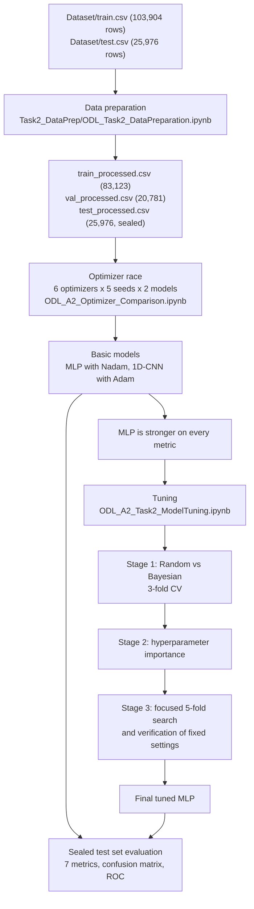
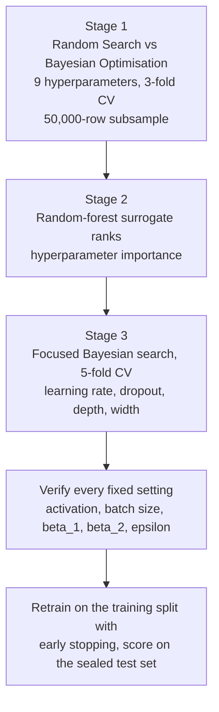

# Airline Passenger Satisfaction: Optimisation and Deep Learning

An end-to-end deep learning project that predicts whether an airline passenger was **satisfied** or **neutral or dissatisfied** from 22 passenger, trip and service-rating features. It was built as a coursework project for an Optimisation and Deep Learning module (APU). The emphasis is on *optimality by evidence*: the training algorithm, the architecture and the hyperparameters are each chosen through a controlled experiment rather than by habit.

The project prepares a 129,880-row tabular dataset, runs a **six-optimizer race** on two architectures (an **MLP** and a **1D-CNN**), tunes the better model with **Random vs Bayesian search and k-fold cross-validation**, and scores everything on a **sealed test set**. The tuned MLP reaches **96.32% accuracy and 0.995 ROC-AUC** on 25,976 unseen passengers.

---

## Table of contents

1. [What it does](#what-it-does)
2. [Pipeline overview](#pipeline-overview)
3. [Project structure](#project-structure)
4. [Setup and run](#setup-and-run)
5. [Walkthrough: data preparation](#walkthrough-data-preparation)
6. [Walkthrough: optimizer race and basic models](#walkthrough-optimizer-race-and-basic-models)
7. [Walkthrough: hyperparameter tuning](#walkthrough-hyperparameter-tuning)
8. [Results](#results)
9. [Figures](#figures)
10. [Troubleshooting](#troubleshooting)
11. [Limitations and next steps](#limitations-and-next-steps)

---

## What it does

- **Cleans and encodes** the raw CSVs in six numbered steps, fitting every data-dependent step (median fill, scaling) on the training portion only to avoid leakage.
- **Compares six optimizers** (SGD, SGD with momentum, RMSprop, Adam, Nadam, AdamW) at default settings, five random seeds each, on both an MLP and a 1D-CNN.
- **Builds two basic models** with the winning optimizer for each, and evaluates them on the sealed test set with seven metrics.
- **Tunes the stronger model (the MLP)** in three stages: a Random vs Bayesian search race, a hyperparameter-importance analysis, and a focused five-fold search, followed by verification of every setting that was fixed.
- **Reports** accuracy, precision, recall, specificity, F1, Matthews correlation coefficient (MCC) and ROC-AUC, plus confusion matrices, ROC curves and training curves.

| Technology | Role |
|---|---|
| Python 3 | Language (the data-prep notebook was saved from a Python 3.13.7 kernel) |
| TensorFlow / Keras | MLP and 1D-CNN models and all six optimizers |
| Keras Tuner | `RandomSearch` and `BayesianOptimization` (with a custom k-fold `run_trial`) |
| scikit-learn | Splits, scaling, k-fold, metrics, random-forest surrogate for hyperparameter importance |
| pandas, NumPy | Data handling |
| Matplotlib, seaborn | All figures |
| Jupyter | Notebook environment |

---

## Pipeline overview



---

## Project structure

Only the project folder is kept in the repository:

```
Airline Satisfaction/
└── ODL/
    ├── Dataset/
    │   ├── train.csv                              # 103,904 rows x 25 columns
    │   └── test.csv                               # 25,976 rows x 25 columns
    │
    ├── ODL_A2_Optimizer_Comparison.ipynb          # optimizer race + two basic models + evaluation
    ├── ODL_A2_Task2_ModelTuning.ipynb             # Random vs Bayesian search, importance, final tuned MLP
    │
    └── Task2_DataPrep/
        ├── ODL_Task2_DataPreparation.ipynb        # EDA + six preparation steps
        ├── train_processed.csv                    # 83,123 rows x 23 columns
        ├── val_processed.csv                      # 20,781 rows x 23 columns
        ├── test_processed.csv                     # 25,976 rows x 23 columns
        │
        ├── 01_target_distribution.png ... 11_categorical_composition.png   # EDA figures
        ├── opt_curves_both.png                    # optimizer race: learning curves
        ├── opt_cross_architecture.png             # optimizer race: final accuracy per model
        ├── opt_time_cost.png                      # optimizer race: run time
        ├── eval_training_curves.png               # basic models: train vs validation
        ├── eval_confusion.png                     # basic models: confusion matrices
        ├── eval_roc.png                           # basic models: ROC curves
        ├── task3_comparison.png                   # MLP baseline vs CNN baseline vs tuned MLP
        ├── tune_convergence.png                   # Stage 1: Random vs Bayesian
        ├── tune_slices.png                        # per-hyperparameter value vs score
        ├── tune_importance.png                    # Stage 2: hyperparameter importance
        ├── tune_focus_convergence.png             # Stage 3: focused 5-fold search
        ├── tune_fixedknob.png                     # verification of the fixed settings
        ├── tune_polish.png                        # beta_1 and epsilon sweeps
        ├── tune_vs_baseline.png                   # tuned vs baseline, seven metrics
        ├── tune_confusion.png                     # tuned model confusion matrix
        └── tune_roc_compare.png                   # baseline vs tuned ROC
```

The dataset source is not recorded anywhere in these files; the notebooks refer to it only as the *Airline Passenger Satisfaction* data. Confirm its origin and licence before redistributing the CSVs.

---

## Setup and run

### 1. Prerequisites

- Python 3.11 or newer
- A CPU is enough; no GPU is required. The tuning notebook trains hundreds of small models and takes tens of minutes.

### 2. Install

There is no requirements file. In a virtual environment:

```bash
pip install numpy pandas scikit-learn matplotlib seaborn jupyter
pip install tensorflow keras-tuner
```

### 3. Run the notebooks in order

Run each notebook top to bottom.

| Step | Notebook (under `Airline Satisfaction/ODL/`) | Reads | Writes |
|---|---|---|---|
| 1 | `Task2_DataPrep/ODL_Task2_DataPreparation.ipynb` | `../Dataset/train.csv`, `../Dataset/test.csv` | `train_processed.csv`, `val_processed.csv`, `test_processed.csv` (in the notebook's folder) |
| 2 | `ODL_A2_Optimizer_Comparison.ipynb` | The three processed CSVs | Figures `opt_*.png` and `eval_*.png` in the notebook's folder |
| 3 | `ODL_A2_Task2_ModelTuning.ipynb` | The three processed CSVs | Figures `tune_*.png` and a `kt_dir/` search folder |

Steps 2 and 3 look for the processed CSVs in `.`, `Task2_DataPrep`, `../Task2_DataPrep` or `Airline Satisfaction/Task2_DataPrep`, so they work when launched from `ODL/`. The saved figures sit in `Task2_DataPrep/`; re-running steps 2 and 3 writes new copies next to the notebooks.

---

## Walkthrough: data preparation

Notebook: `Task2_DataPrep/ODL_Task2_DataPreparation.ipynb` (saved with outputs; every number in this section comes from them).

### Exploratory data analysis

| Check | Result |
|---|---|
| Shape | Train (103,904, 25), test (25,976, 25) |
| Target balance (train) | 56.67% neutral or dissatisfied (58,879), 43.33% satisfied (45,025) |
| Missing values (train) | Only `Arrival Delay in Minutes`: 310 rows |
| Exact duplicate rows | 0 (ignoring the two id columns) |
| Strongest correlations with satisfaction | Online boarding 0.504, Class 0.494, Type of Travel 0.449, Inflight entertainment 0.398 |
| Weakest | Gate location 0.001, Gender 0.012, Departure delay -0.050, Arrival delay -0.057 |
| Arrival delay | Median 0.0 min, mean 15.18 min, skewness 6.60, 56.1% of flights on time, maximum 1,584 min |

The features are six passenger and trip fields (gender, customer type, age, type of travel, class and flight distance), fourteen 0 to 5 service ratings, and two delay columns. The median rather than the mean is used to fill the missing arrival delays because the column is heavily skewed (see `08_delay_median_justification.png`).

### Six preparation steps


- **Step 3** keeps the supplied test file sealed and splits the training file into 83,123 training and 20,781 validation rows.
- **Steps 4 and 6** learn from the training portion only and are then applied to validation and test.
- The three binary columns (`Gender`, `Customer Type`, `Type of Travel`) are left unscaled.
- The result is **22 features and no missing values**; each saved CSV has 23 columns (22 features plus `satisfaction`).

---

## Walkthrough: optimizer race and basic models

Notebook: `ODL_A2_Optimizer_Comparison.ipynb`. It was saved **without outputs**, so the numbers below are read from the figures in `Task2_DataPrep/` (`opt_*.png`, `eval_*.png`) and from the notebook's own conclusion text.

### Models (identical for every optimizer)

| Model | Architecture |
|---|---|
| MLP | `Dense(64, relu)`, `Dense(32, relu)`, `Dense(1, sigmoid)` on the 22 features |
| 1D-CNN | Input shaped `(22, 1)`, `Conv1D(32, 3)`, `Conv1D(64, 3)`, `GlobalMaxPooling1D`, `Dense(32, relu)`, `Dense(1, sigmoid)` |

### The race

Six optimizers at default settings: SGD (0.01), SGD with momentum (0.01, 0.9), RMSprop (0.001), Adam (0.001), Nadam (0.001), AdamW (0.001). Every optimizer trains the same model with binary cross-entropy for **30 epochs, batch size 512, five seeds**, recording validation accuracy and loss every epoch plus run time.

| Optimizer | MLP best val accuracy (%) | CNN best val accuracy (%) |
|---|---|---|
| SGD | 91.68 | 84.78 |
| SGD + Momentum | 95.15 | 92.07 |
| RMSprop | 95.61 | 92.11 |
| Adam | 95.63 | **92.96** |
| Nadam | **95.69** | 92.93 |
| AdamW | 95.67 | 92.96 |

(Source: `opt_cross_architecture.png`, mean of five runs; the "best" value is each run's highest validation accuracy over its 30 epochs.)

What the notebook concludes from the race:

- SGD is clearly weakest on both models and never reaches the target accuracy (`opt_time_cost.png`).
- Adam, Nadam and AdamW are a statistical tie; the leader differs by architecture, so the notebook gives each model its own winner: **Nadam for the MLP, Adam for the CNN** (AdamW as a fallback).
- The CNN costs about three times as much as the MLP per 30-epoch run (about 39 to 44 s vs 12 to 14 s in `opt_time_cost.png`).

### Basic models and their evaluation

Both are trained for 40 epochs (batch 512, seed 42) and scored on the sealed test set (`eval_confusion.png`, `eval_roc.png`, `eval_training_curves.png`):

| | MLP (Nadam) | CNN (Adam) |
|---|---|---|
| Confusion matrix (TN / FP / FN / TP) | 14,153 / 420 / 687 / 10,716 | 13,714 / 859 / 850 / 10,553 |
| Accuracy, computed from the matrix | 95.74% | 93.42% |
| Precision, computed from the matrix | 96.23% | 92.47% |
| Recall, computed from the matrix | 93.98% | 92.55% |
| ROC-AUC (from `eval_roc.png`) | 0.993 | 0.982 |

Training and validation curves stay close together for 40 epochs, so neither model visibly overfits. The notebook concludes that the **MLP wins on every metric**, because a fully connected network reads all 22 features together while a convolution assumes local structure that flat tabular columns do not strongly have, and carries the MLP forward to tuning.

---

## Walkthrough: hyperparameter tuning

Notebook: `ODL_A2_Task2_ModelTuning.ipynb`. It was also saved **without outputs**; results below are read from the `tune_*.png` figures. Nadam stays fixed as the optimizer type; its learning rate, `beta_1`, `beta_2` and `epsilon` enter the search so their influence is measured rather than assumed.



### Search space (Stage 1)

| Hyperparameter | Range |
|---|---|
| Learning rate | 1e-4 to 1e-2 (log scale) |
| Number of layers | 1 to 3 |
| Units per layer | 32, 64, 128, 256 |
| Dropout | 0.0 to 0.4 |
| Activation | relu, tanh, elu |
| Batch size | 128, 256, 512 |
| Nadam beta_1 / beta_2 / epsilon | 0.85 to 0.95 / 0.99 to 0.9999 / 1e-8 to 1e-6 |

Each trial's score is the **mean validation accuracy across k folds** (a custom `run_trial` on top of Keras Tuner), using identical folds for both searchers so the comparison is fair.

### Findings

| Stage | Finding (figure) |
|---|---|
| 1 | Bayesian optimisation beat random search on the same budget: **95.82% vs 95.38%** best 3-fold CV accuracy over 28 trials each (`tune_convergence.png`). |
| 2 | **Learning rate explains 79.1%** of the variation in score; dropout is next at 8.0%; Nadam beta_1 and epsilon (2.6% each), units and activation (2.3% each), beta_2 (1.7%), layers (0.9%) and batch size (0.4%) matter little (`tune_importance.png`). `tune_slices.png` shows only the learning-rate panel has a clear trend. |
| 3 | The focused 5-fold search reaches **96.24%** best CV accuracy over 16 trials, above the Stage 1 best (`tune_focus_convergence.png`). |
| Verify | Batch size, beta_1, beta_2 and epsilon are flat within noise, so their defaults are kept; **relu clearly beats tanh and elu** (about 95.75% vs 95.46% and 95.27% in `tune_fixedknob.png`; `tune_polish.png` repeats the beta_1 and epsilon sweeps). |

The focused search fixes `activation = relu`, `batch_size = 256`, `beta_1 = 0.9`, `beta_2 = 0.999`, `epsilon = 1e-7` and searches learning rate (0.003 to 0.03), layers (2 to 3), units (128 or 256) and dropout (0.0 to 0.2). The values the focused search finally selected are not printed anywhere in the kept files, so they are not listed here; re-run the notebook to obtain them.

---

## Results

Test-set comparison of the basic MLP and the tuned MLP (25,976 sealed passengers, 0.5 cut-off), read from `tune_vs_baseline.png`:

| Metric | Baseline MLP | Tuned MLP | Change |
|---|---|---|---|
| Accuracy | 95.74% | **96.32%** | +0.58 |
| Precision | 96.23% | **98.09%** | +1.86 |
| Recall | **93.98%** | 93.45% | -0.53 |
| Specificity | 97.12% | **98.57%** | +1.45 |
| F1-score | 95.09% | **95.71%** | +0.62 |
| MCC | 0.913 | **0.926** | +0.013 |
| ROC-AUC | 0.993 | **0.995** | +0.002 |

- **Tuned confusion matrix** (`tune_confusion.png`): 14,365 true negatives, 208 false positives, 747 false negatives, 10,656 true positives. False alarms fall from 420 (baseline) to 208 at the cost of 60 more missed satisfied passengers.
- **ROC** (`tune_roc_compare.png`): the tuned curve sits above the baseline across the top-left region, with AUC 0.995 vs 0.993.
- **Architecture matters more than tuning here.** The MLP beats the 1D-CNN by more than two accuracy points before any tuning (95.74% vs 93.42%); tuning then adds a smaller, genuine refinement and improves six of seven metrics.
- `task3_comparison.png` plots the MLP baseline, CNN baseline and tuned MLP side by side on all seven metrics (bars only, no printed values).

The notebooks that recomputed these three models together are not part of this repository; the figures above are the record of the results.

---

## Figures

| Group | Files | What they show |
|---|---|---|
| EDA | `01` to `11` | Target distribution, numeric histograms, service-rating distributions, satisfaction by category, mean rating by satisfaction, correlation heatmap, delay boxplots, median-vs-mean justification, signal and separability, local structure, categorical composition |
| Optimizer race | `opt_curves_both`, `opt_cross_architecture`, `opt_time_cost` | Accuracy and loss per epoch (mean of five runs, shaded standard deviation), final accuracy by optimizer and model, and run time |
| Basic-model evaluation | `eval_training_curves`, `eval_confusion`, `eval_roc` | Train vs validation curves, confusion matrices, ROC curves |
| Tuning | `tune_convergence`, `tune_slices`, `tune_importance`, `tune_focus_convergence`, `tune_fixedknob`, `tune_polish` | Search convergence, value-vs-score plots, importance ranking, focused search, fixed-setting checks |
| Final comparison | `tune_vs_baseline`, `tune_confusion`, `tune_roc_compare`, `task3_comparison` | Tuned vs baseline metrics, confusion matrix, ROC, three-model bar chart |

---

## Troubleshooting

| Problem | What to check |
|---|---|
| `Could not find train_processed.csv` | Run the data-preparation notebook first, or launch the modelling notebooks from `ODL/` so the `Task2_DataPrep` lookup works |
| Data-prep notebook cannot find `train.csv` | It reads `../Dataset/train.csv`, so run it with `Task2_DataPrep/` as the working folder |
| `ModuleNotFoundError: keras_tuner` | `pip install keras-tuner` |
| The tuning run is slow | Lower `MAX_TRIALS`, `MAX_TRIALS_F`, `MAX_EPOCHS` or `FOLDS` at the top of the cells |
| Re-run numbers differ slightly from the figures | The notebook ships with reduced search budgets (15 Stage 1 trials and 12 Stage 3 trials, with a comment that the saved figures used a larger budget; the figures show 28 and 16 trials), and TensorFlow results vary a little across machines |
| TensorFlow does not use the GPU on Windows | Recent TensorFlow has no native Windows GPU support; run on CPU or under WSL2 |

---

## Limitations and next steps

- **One dataset.** Everything comes from a single self-reported survey, so the numbers describe this data well but are not a universal ranking of the methods. Testing on a second, independent airline dataset would show whether the accuracy transfers.
- **Two notebooks carry no saved outputs.** The optimizer comparison and the tuning notebooks were committed without results; their numbers live in the figures. Only the data-preparation notebook keeps its printed outputs, and the notebook that put all three models side by side is not included.
- **The selected tuned configuration is not recorded** in any kept file (see above).
- **Slightly optimistic validation scores.** The optimizer race and the cross-validated search score each run by its best epoch's validation accuracy (`max(val_accuracy)`), which favours the best moment rather than the final model; the sealed test set is only used for the final comparison.
- **Small gain from tuning.** The tuned MLP improves accuracy by 0.58 points and gives back 0.53 points of recall; it is slightly conservative, calling fewer passengers satisfied.
- **Modest search budget.** The learning rate dominates the score, but the search used small trial counts, a 50,000-row subsample and few epochs; wider, deeper and longer searches could still help.
- **Feature engineering is untried.** The raw ratings are used as-is, and the 1D-CNN depends on the column order of the CSV, which is a presentation choice rather than a property of the data.
- **Repository hygiene.** There is no requirements file. The root `.gitignore` restricts publication to this airline project and excludes unrelated university materials. The processed CSVs (about 49 MB in total) can be regenerated by the data-preparation notebook; the raw `train.csv` is about 12 MB and `test.csv` about 3 MB.
